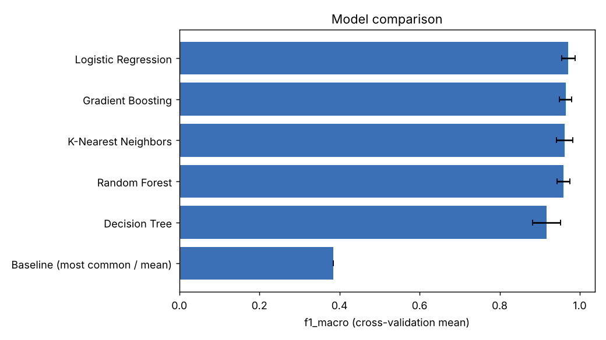
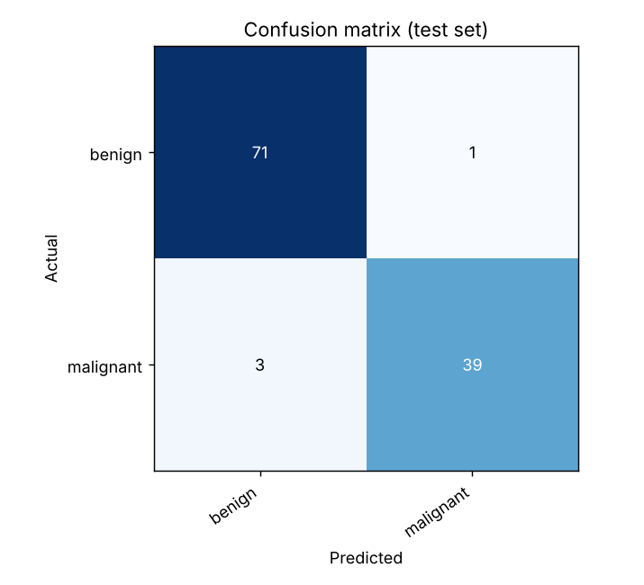
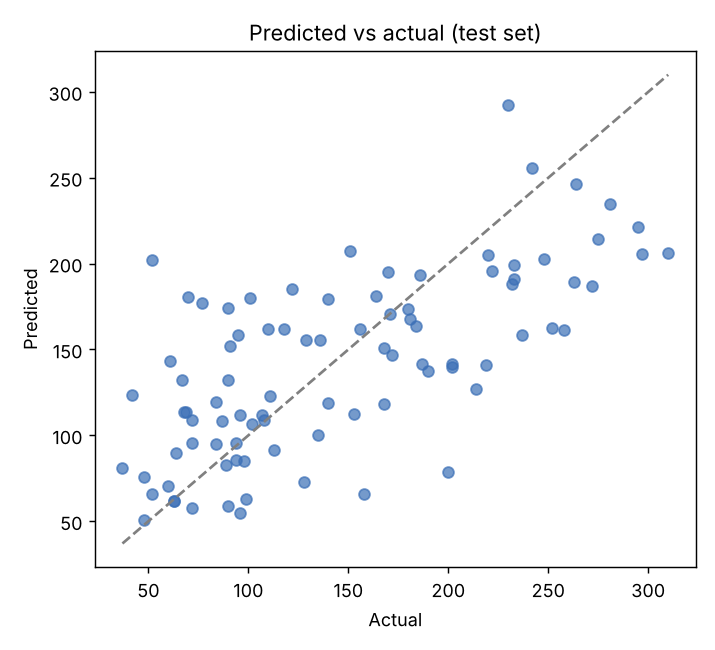

# MLCompare

A command-line tool that takes any CSV file and a target column, then automatically compares several machine-learning models, tunes the best one, evaluates it on held-out data, explains which features matter, and saves the trained model. It handles classification and regression, missing values, and categorical columns.

## Features

- Automatic task detection (classification or regression), with a manual override
- Preprocessing built into every model: median imputation and scaling for numeric columns, most-frequent imputation and one-hot encoding for categorical columns
- Cross-validated comparison of five models plus a baseline, so you can see whether a model is actually learning
- Grid-search tuning of the best model
- Honest evaluation: the test split is held out before any comparison or tuning
- Permutation importance to show which features drive the predictions
- Saved model, Markdown report, JSON metrics, comparison table, and charts
- A `predict` command for new data, which accepts unseen categories and extra columns

## Requirements

- Python 3.9 or later
- Packages in `requirements.txt` (numpy, pandas, scikit-learn, matplotlib, joblib)

## Installation

```bash
python -m venv .venv
# Windows: .venv\Scripts\activate
# macOS/Linux: source .venv/bin/activate
pip install -r requirements.txt
```

## Usage

```bash
# Compare models, tune the best, evaluate, explain, and save everything to outputs/
python -m mlcompare run --data examples/breast_cancer.csv --target diagnosis

# A regression example
python -m mlcompare run --data examples/diabetes.csv --target progression --out outputs_diabetes

# Predict with the saved model
python -m mlcompare predict --model outputs/model.joblib --data new_data.csv --out predictions.csv
```

### Options for `run`

| Option | Description |
|--------|-------------|
| `--data` | CSV file (required) |
| `--target` | Name of the column to predict (required) |
| `--task` | `classification` or `regression` (default: detected automatically) |
| `--out` | Output folder (default: `outputs`) |
| `--folds` | Cross-validation folds (default: 5) |
| `--seed` | Random seed (default: 42) |
| `--no-tune` | Skip hyper-parameter tuning for a faster run |

### Output files

| File | Content |
|------|---------|
| `model.joblib` | The trained preprocessing and model pipeline |
| `report.md` | Full report with tables and metrics |
| `metrics.json` | Test-set metrics in JSON |
| `comparison.csv` | Cross-validation results for all models |
| `model_comparison.png` | Bar chart of the model comparison |
| `permutation_importance.png` | Most important features |
| `confusion_matrix.png` or `predicted_vs_actual.png` | Test-set results |

## Example results

Both example datasets are bundled with scikit-learn. The results below come from running the commands above with the default settings (80/20 split, seed 42).

### Classification: breast cancer diagnosis (569 rows, 30 features)

| Model | F1 (macro) | Accuracy |
|-------|-----------|----------|
| Logistic Regression | 0.972 | 0.974 |
| Gradient Boosting | 0.965 | 0.967 |
| K-Nearest Neighbors | 0.962 | 0.965 |
| Random Forest | 0.960 | 0.963 |
| Decision Tree | 0.918 | 0.923 |
| Baseline (most common) | 0.385 | 0.626 |

The tuned Logistic Regression scored 0.965 accuracy, 0.962 macro F1 and 0.996 ROC AUC on the held-out test set of 114 rows.





### Regression: diabetes disease progression (442 rows, 10 features)

| Model | R² | RMSE | MAE |
|-------|-----|------|-----|
| Ridge Regression | 0.481 | 55.374 | 44.999 |
| Random Forest | 0.409 | 58.931 | 48.360 |
| Gradient Boosting | 0.365 | 61.198 | 49.614 |
| K-Nearest Neighbors | 0.345 | 62.110 | 49.442 |
| Baseline (mean) | -0.027 | 78.134 | 66.867 |
| Decision Tree | -0.124 | 81.041 | 62.273 |

The tuned Ridge Regression scored R² 0.457 and RMSE 53.6 on the held-out test set of 89 rows. This is a hard dataset with a modest ceiling, and the simplest model won, which is a useful reminder that a more complex model is not always better. The most important features were `s5` and `bmi`.



## How it works

1. **Load:** rows with a missing target are dropped, and columns that are entirely empty are removed.
2. **Split:** 20% of the rows are held out as a test set (stratified for classification). Nothing below uses them until the final evaluation.
3. **Compare:** each candidate model is wrapped in a pipeline with preprocessing and cross-validated on the training rows, so preprocessing is fitted inside each fold and no information leaks.
4. **Tune:** the best real model (never the baseline) is tuned with a small grid search.
5. **Evaluate:** the tuned model is scored once on the held-out test set.
6. **Explain:** permutation importance on the test set shows how much the score drops when each original column is shuffled.

## Running the tests

```bash
python -m unittest discover -s tests -v
```

The tests cover task detection, cleaning, missing values, categorical and boolean columns, unseen categories at prediction time, tuning, saving and loading, and the full command-line workflow.

## Limitations

- It is a baseline tool, not a replacement for careful feature engineering and domain knowledge.
- Only tabular CSV data is supported. Text, images, and time series need different methods.
- The grids are small to keep runs fast, so results can sometimes be improved with larger searches.
- High-cardinality categorical columns (such as IDs) create many one-hot columns, so drop them before running.
- The breast cancer example is for learning only. This project is not a medical tool.
- Model files are saved with joblib. Only load model files that you trained yourself or trust.

## Possible improvements

- Add XGBoost or LightGBM as candidates
- Handle text columns with TF-IDF
- Add SHAP explanations and learning curves
- Add class-imbalance handling and threshold tuning

## Data sources

The example files were exported from the datasets bundled with scikit-learn: the Breast Cancer Wisconsin (Diagnostic) dataset and the Diabetes dataset.

## License

MIT License. See the `LICENSE` file.
